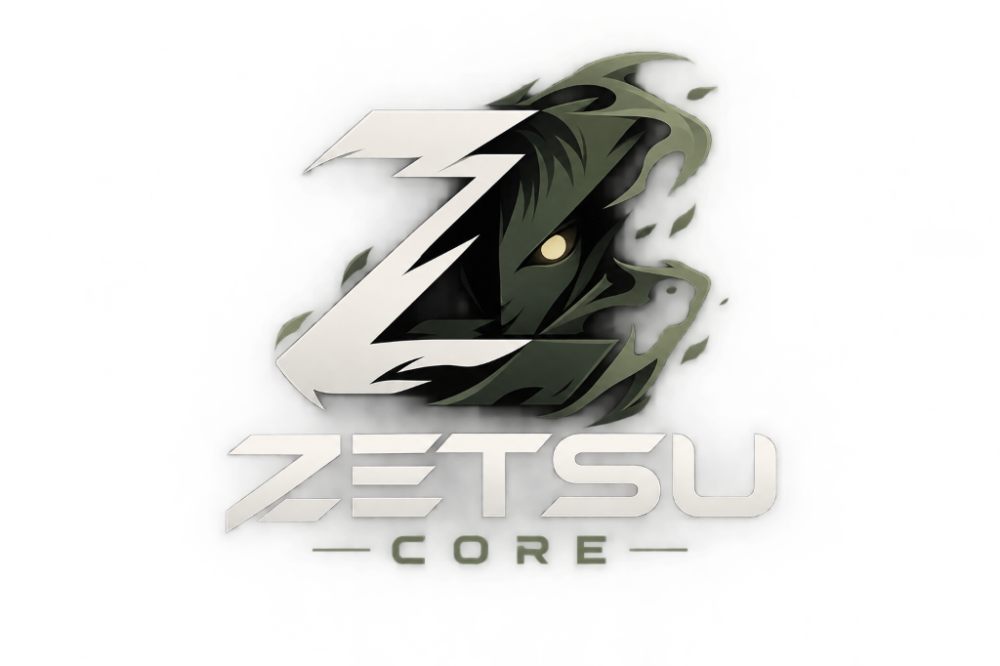

<p align="center">
  
</p>

<p align="center">
  <em>"The all-seeing media intelligence desktop."</em><br />
  A premium, cinematic desktop streaming application for <b>Movies</b>, <b>TV Shows</b>, and <b>Live Sports</b>.
</p>

<p align="center">
  
  
  
  
  
</p>

---

## 🌟 Overview

**Zetsu Desktop** combines the cinematic feel of commercial streaming platforms with dedicated live sports broadcast features, built on top of **Tauri v2**, **React**, and **Zetsu Core**:

- 🔑 **Onboarding Setup**: On initial launch, prompts for your free **TMDB API Key** (with live validation) to unlock high-res posters, release years, cast, seasons, and episodes.
- ⚽ **Live Sports Arena**: Football, Basketball (NBA), Motorsport (Formula 1), Combat (UFC), Tennis, and Hockey with live scoreboards, match status, and decrypted feeds.
- 🎬 **Cinema Catalog**: Browse trending movies and popular series with genre chips and sort filters.
- 📺 **TV Series Browser**: Season-by-season episode list with thumbnails, runtime, and 1-click play.
- ⚡ **Immersive Video Player**:
  - HLS `.m3u8` live streaming & direct MP4 playback.
  - Seekbar with buffered progress, volume control, mute, fullscreen.
  - Subtitle track selector (Indonesian 🇮🇩 & English 🇬🇧).
  - Playback speed controls (0.5x to 2x).
  - Picture-in-Picture (PiP).
  - Keyboard shortcuts (`Space` = Play/Pause, `F` = Fullscreen, `M` = Mute, `←/→` = Seek 10s).
- 🔍 **Instant Spotlight Search (`Ctrl + K`)**: Debounced search across movies, series, and sports events.
- 💾 **Local Persistence**: Tracks your **Continue Watching** progress and **My List** locally.

---

## 🚀 Getting Started

### 1. Installation

```bash
cd d:\zetsu
npm install
```

### 2. Development Mode

To run in your desktop browser or webview immediately:

```bash
npm run dev
```
Open [`http://localhost:1420`](http://localhost:1420) in your browser.

### 3. Tauri Desktop Mode (Native Window)

If you have Rust and the Microsoft C++ Build Tools installed:

```bash
npm run tauri dev
```

To build a standalone Windows `.exe` / MSI installer:

```bash
npm run tauri build
```

---

## ⚙️ Backend Integration

Zetsu Desktop connects seamlessly to your local **Zetsu Core** API server (running at `http://localhost:3000` by default):

1. Start Zetsu Core in another terminal:
   ```bash
   cd d:\zetsu-core
   npm start
   ```
2. Zetsu Desktop will automatically show a green connection indicator in the top bar!
3. If the backend is not yet started, Zetsu Desktop will automatically display fallback mock feeds so the entire UI remains 100% interactive and functional.

---

## 🛡️ License

MIT License © 2026 Zetsu Core Contributors.
